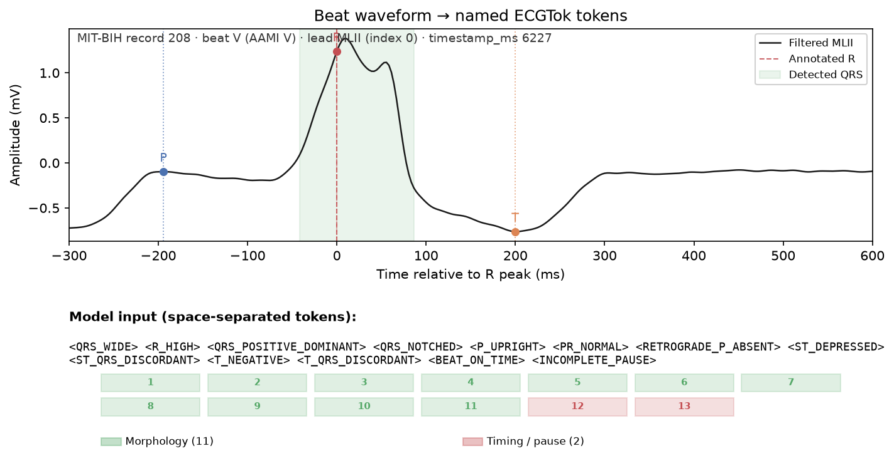

# ecgtok

A human-readable taxonomy that turns one ECG beat into tokens for a language model.

Named tokens for one MIT-BIH beat, set against three other inputs on the same window: opaque energy codes, fixed-scale codes, and input alignment into Qwen. All four are classified by the same Qwen2.5-1.5B LoRA. The named tokens are measurements a reading already uses. The other three do not name a measurement.

The tokens are defined in [docs/taxonomy.md](docs/taxonomy.md). Fixed-scale codes and input alignment, the two adapted inputs, are specified in [docs/adapted.md](docs/adapted.md). This page states the protocol, the scores, and how to rerun them.

## From waveform to tokens

Each annotated beat is cut to **300 ms before R** and **600 ms after R** on the lead you choose. Measurements on that window become **13 named tokens** (for example `<QRS_WIDE>`, `<T_NEGATIVE>`).



Pick any beat after you have the database under `data/mitdb`:

```powershell
uv sync --extra dev
uv run python scripts/visualize_beat.py --record 208 --timestamp-ms 6222 --lead MLII `
  --out docs/figures/my_beat.png
# or use the WFDB channel index instead of the lead name:
uv run python scripts/visualize_beat.py --record 208 --timestamp-ms 6222 --lead-index 0
# list channels on a record:
uv run python scripts/visualize_beat.py --record 208 --list-leads
```

## Protocol

Beats are the MIT-BIH Arrhythmia Database QRS annotations that map to an AAMI class [1], [3]. The lead is MLII. Paced records 102, 104, 107, and 217 are excluded. The remaining records follow the de Chazal DS1/DS2 division [2].

DS1 trains the model. The last 15% of each DS1 record, in time, selects the epoch. For ventricular versus rest, that same slice selects the decision threshold by F1, over 0.05 to 0.95 in steps of 0.05. DS2 is scored once from the selected checkpoint. It is not used to choose an epoch or a threshold.

Four tasks:

- Ventricular ectopic beats versus the rest (`V` and `E` against every other AAMI class). The reported F1 is the F1 of the ventricular class.
- Five AAMI classes: N, S, V, F, Q.
- The MIT-BIH beat symbols that appear in DS1 training, without collapsing them.
- The rhythm label in force at the beat, taken from annotation notes that start with `(`.

Macro AUC is the mean of one-versus-rest AUCs over classes that have both positives and negatives on that split. Macro F1 uses the same classes. A class that is missing from a split is omitted from that split's mean, not filled in as zero.

Four inputs share that window.

- Named tokens, one symbol per measurement. Cut points are in [docs/taxonomy.md](docs/taxonomy.md).
- Opaque codes. Twelve RMS bins, in tenths of a millivolt, clipped at 5.0 mV, with no clinical names.
- Fixed-scale codes, adapted from HeartLLM [6], [8]. A small encoder writes 13 integers in `0 … 624`. It is trained to reconstruct DS1 beats, then frozen. This run does not pretrain Qwen to forecast the codes, and it uses one MLII lead rather than a 12-lead record. See [docs/adapted.md](docs/adapted.md).
- Input alignment, adapted from TIME-LLM [7]. Thirteen patches of 25 samples are aligned, by one cross-attention block, to 64 frozen rows of Qwen's input embedding. TIME-LLM forecasts the series. Here the head classifies the beat.

The model is Qwen2.5-1.5B [4]. LoRA adapts `q_proj` and `v_proj` with rank 16 and alpha 32 [5]. New token rows are a separate float32 table. Pretrained embedding rows stay frozen. Training uses AdamW at `1e-4`, batch 64, two epochs, seed 42, and a maximum length of 24. A non-finite loss or gradient aborts the run. The binary loss is weighted by the negative-to-positive ratio. Multiclass loss uses inverse-frequency weights, capped at 10.

## Results

The table is the seed-42 run. Named and opaque numbers are in [results/mitbih_qwen.json](results/mitbih_qwen.json). Fixed-scale and alignment numbers are in [results/adapted_qwen.json](results/adapted_qwen.json). A later run can move the third decimal: the seed fixes the initialization and the shuffle, not every GPU kernel.

The highest value in each row is bold. A tie is bold in every tied cell. DS2 is the held-out split. Named tokens have the highest DS2 AUC and the highest DS2 F1 on all four tasks. DS1 validation, which selected the epoch, ranks the inputs differently. Input alignment has the highest AUC there for AAMI-5, symbols, and rhythm. Named tokens lead that slice only on ventricular versus rest.

| Task | Split | Metric | Named | Opaque | FSQ | Align |
|---|---|---|---:|---:|---:|---:|
| Ventricular vs rest | DS1-val | AUC | **0.986** | 0.946 | 0.970 | 0.970 |
| Ventricular vs rest | DS1-val | F1 | **0.859** | 0.652 | 0.698 | 0.714 |
| Ventricular vs rest | DS2 | AUC | **0.969** | 0.929 | 0.942 | 0.925 |
| Ventricular vs rest | DS2 | F1 | **0.650** | 0.508 | 0.609 | 0.550 |
| AAMI-5 | DS1-val | AUC | 0.784 | 0.827 | 0.854 | **0.882** |
| AAMI-5 | DS1-val | F1 | **0.515** | 0.429 | **0.515** | 0.460 |
| AAMI-5 | DS2 | AUC | **0.771** | 0.685 | 0.704 | 0.707 |
| AAMI-5 | DS2 | F1 | **0.337** | 0.263 | 0.284 | 0.286 |
| Beat symbols | DS1-val | AUC | 0.834 | 0.845 | 0.881 | **0.905** |
| Beat symbols | DS1-val | F1 | 0.351 | 0.349 | 0.421 | **0.469** |
| Beat symbols | DS2 | AUC | **0.679** | 0.611 | 0.631 | 0.662 |
| Beat symbols | DS2 | F1 | **0.220** | 0.143 | 0.141 | 0.128 |
| Rhythm | DS1-val | AUC | 0.719 | 0.826 | 0.792 | **0.833** |
| Rhythm | DS1-val | F1 | 0.218 | 0.321 | 0.350 | **0.417** |
| Rhythm | DS2 | AUC | **0.712** | 0.614 | 0.672 | 0.707 |
| Rhythm | DS2 | F1 | **0.156** | 0.124 | 0.153 | 0.130 |

Ventricular F1 is the positive-class F1. Every other F1 is a macro F1. Epoch 2 was selected for both named and opaque arms of ventricular versus rest, symbols, and rhythm, and for the opaque arm of AAMI-5. The named AAMI-5 arm selected epoch 1 (DS1-val macro AUC 0.784, against 0.768 at epoch 2). DS2 for that arm is the epoch-1 checkpoint. Among the adapted arms, only AAMI-5 alignment selected epoch 1 (DS1-val macro AUC 0.882, against 0.873 at epoch 2). The rest selected epoch 2.

Ventricular thresholds, chosen on DS1 validation: 0.80 named, 0.85 opaque. At those thresholds the DS2 operating point is sensitivity 0.859 and positive predictive value 0.523 for named tokens, against 0.704 and 0.397 for opaque codes. The AUC gain does not mean the ventricular decisions are precise.

AAMI-5 validation has no Q beats in the DS1 tails, so that macro AUC is the mean of N, S, V, and F. DS2 scores all five. Named DS2 AUCs: F 0.865, N 0.789, Q 0.776, S 0.483, V 0.939. Opaque: F 0.606, N 0.795, Q 0.452, S 0.667, V 0.906. Supraventricular beats are the class the named tokens do not win.

Symbol `S` has two beats in the whole set and is not scored on DS2. Nine symbol classes are scored on DS1 validation and ten on DS2.

Rhythm DS2, named against opaque: AFIB 0.794 / 0.660, AFL 0.754 / 0.509, VT 0.895 / 0.710, B 0.828 / 0.665, N 0.711 / 0.672, NOD 0.663 / 0.527, SVTA 0.604 / 0.589, T 0.443 / 0.578. Nine rhythm classes are scored on DS1 validation and eight on DS2. Ventricular flutter is annotated in the database, but those annotations do not fall on QRS beats in this table, so flutter is not a class.

## Embedding size and forward cost

The token lists and the block diagram are in [docs/taxonomy.md](docs/taxonomy.md). A named beat is 13 tokens drawn from 49 symbols. An opaque beat is 12 tokens drawn from 612 symbols, twelve segments times the 51 tenths from 0 through 50. A fixed-scale beat is 13 tokens drawn from 625 codes, the integers `0` through `624`. Input alignment is 13 vectors of width 1536, not a token string. The first three enter Qwen as token ids [4]. Alignment enters it as `inputs_embeds`.

The learned embedding table has one float32 row of length 1536 for each symbol that occurs in DS1 training, plus `<ECG_UNK>`. In the reported named and opaque tables that is 34 named symbols, so 35 rows, and 363 opaque codes, so 364 rows. Fifteen named symbols never occur in this MIT-BIH table and receive no row: `<QRS_NARROW>`, `<QRS_MEDIUM>`, `<QRS_WIDE>`, `<QRS_VERY_WIDE>`, `<QRS_NOTCHED>`, `<RETROGRADE_P_PRESENT>`, `<ST_ELEVATED>`, `<ST_DEPRESSED>`, `<ST_QRS_CONCORDANT>`, `<ST_QRS_DISCORDANT>`, `<T_POSITIVE>`, `<T_NEGATIVE>`, `<T_FLAT>`, `<T_QRS_CONCORDANT>`, and `<T_QRS_DISCORDANT>`. Every reported duration token is `<QRS_VERY_NARROW>`. Twenty-four opaque codes appear only outside DS1 training and are mapped to `<ECG_UNK>` at evaluation. Fixed-scale codes follow the same rule. The saved scores do not record how many of the 625 codes occur in DS1 training, so the fixed-scale line below is the full code space. Alignment trains no token table. It copies 64 frozen rows into a buffer.

| Table | Rows | Bytes |
|---|---:|---:|
| Named, reported run | 35 × 1536 | 215,040 (210 KiB) |
| Opaque, reported run | 364 × 1536 | 2,236,416 (2.13 MiB) |
| Named, full vocabulary plus the unknown row | 50 × 1536 | 307,200 (300 KiB) |
| Opaque, full code space plus the unknown row | 613 × 1536 | 3,766,272 (3.59 MiB) |
| Fixed-scale, full code space plus the unknown row | 626 × 1536 | 3,846,144 (3.67 MiB) |
| Alignment prototypes, copied, not trained | 64 × 1536 | 393,216 (384 KiB) |
| Pretrained Qwen table, float16, frozen, every input | 151,936 × 1536 | 466,747,392 (445 MiB) |

The opaque table in the reported run is 364/35 ≈ 10.4 times the named table. The full fixed-scale table is 626/50 ≈ 12.5 times the full named table. Next to the frozen 445 MiB table, and next to the roughly 5 GB training footprint at batch 64, those token tables are a small part of the memory.

Two modules sit outside that table. The fixed-scale quantizer has 17,477 parameters (69,908 bytes). It reconstructs DS1 beats for 5 epochs and is then deleted. The classification forward does not run it. Input alignment trains a linear map from 25 samples to 1536 and one 4-head attention block: 9,483,264 parameters, 37,933,056 bytes (36.2 MiB). That block is larger than any of the token tables. It is still small next to the frozen table.

The transformer cost of one beat is Θ(N (L H² + L H F + L² H)), with N = 28, H = 1536, and F = 8960. N, H, and F are the same on all four inputs. L is 12 for opaque codes and 13 for named tokens, fixed-scale codes, and input alignment. Projections and the SwiGLU therefore cost 13/12 as much on those three as on the opaque arm, and the attention scores cost (13/12)² as much. At this length the linear term is nearly the whole multiply-add count, so those three beats are about 13/12 the transformer work of an opaque beat.

Alignment adds one block before those 28 layers. The patch linear map is 13 × 25 × 1536 multiply-adds. The attention projections are (13 + 64 + 64 + 13) H² multiply-adds, one matrix each for the queries, the keys, the values, and the output. The two multiplies against the 64 prototypes are 2 × 13 × 64 × H. The block runs once, so the transformer is still most of the work. LoRA rank 16 on `q_proj` and `v_proj` is the same on every input. Activation memory of the transformer scales with L. These figures come from the shapes. The four inputs were not timed separately.

## Reproduce

The database and the weights are downloaded. They are not in git.

```powershell
uv sync --extra dev --extra train
uv run python scripts/download_mitbih.py data/mitdb
uv run python scripts/download_qwen.py
uv run python scripts/build_beats.py data/mitdb cache/beats.parquet
uv run python scripts/train_qwen.py cache/beats.parquet
uv run python scripts/train_adapted.py data/mitdb models/Qwen2.5-1.5B
```

`train_adapted.py` reads the recordings directly and writes `results/adapted_qwen.json`. It needs the same GPU recipe.

`train_qwen.py` reads `models/Qwen2.5-1.5B`. The reported recipe needs a CUDA GPU. Batch 64 uses about 5 GB. The script writes `runs/qwen_mitbih.json` and `runs/train.log`.

## References

[1] G. B. Moody and R. G. Mark, "The impact of the MIT-BIH arrhythmia database," *IEEE Eng. Med. Biol. Mag.*, vol. 20, no. 3, pp. 45–50, May/Jun. 2001.

[2] P. de Chazal, M. O'Dwyer, and R. B. Reilly, "Automatic classification of heartbeats using ECG morphology and heartbeat interval features," *IEEE Trans. Biomed. Eng.*, vol. 51, no. 7, pp. 1196–1206, Jul. 2004.

[3] Association for the Advancement of Medical Instrumentation, *Testing and reporting performance results of cardiac rhythm and ST-segment measurement algorithms*, ANSI/AAMI EC57:2012.

[4] Qwen Team, "Qwen2.5 technical report," arXiv:2412.15115, 2024.

[5] E. J. Hu *et al.*, "LoRA: Low-rank adaptation of large language models," in *Proc. Int. Conf. Learn. Represent.*, 2022.

[6] J. Yang *et al.*, "HeartLLM: Discretized ECG tokenization for LLM-based diagnostic reasoning," arXiv:2508.15338, 2025.

[7] M. Jin *et al.*, "Time-LLM: Time series forecasting by reprogramming large language models," in *Proc. Int. Conf. Learn. Represent.*, 2024.

[8] F. Mentzer, D. Minnen, E. Agustsson, and M. Tschannen, "Finite scalar quantization: VQ-VAE made simple," in *Proc. IEEE/CVF Int. Conf. Comput. Vis.*, 2023.
