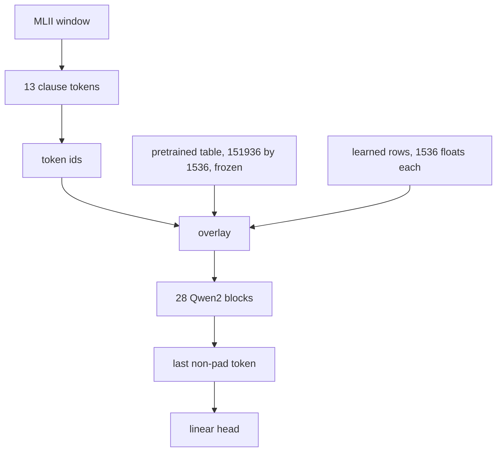
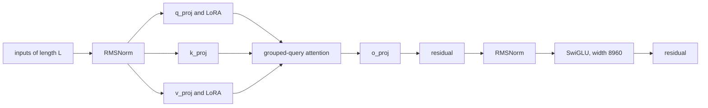

# Beat tokens

A cardiologist does not read a beat as a list of samples. The report names a few measurements: whether the QRS is wide, whether the R wave is small, whether the ST segment is elevated, whether the beat came early. The tokens are those names, one symbol each.

The window is MLII, 300 ms before the annotated R peak and 600 ms after, at 360 Hz, after a 0.6–40 Hz FIR bandpass. The R peak is the center of that window. QRS onset and offset are the stretch around the R peak where the derivative stays in the top 30 percent. Duration is that stretch in milliseconds.

| Measurement | Cut points |
|---|---|
| QRS duration | 80, 100, 120, 160 ms |
| R-wave amplitude, absolute | 0.15, 0.50, 0.80, 1.50 mV |
| ST level, 80 ms after QRS offset | −0.10 and +0.10 mV |
| T-wave amplitude | −0.10 and +0.10 mV; absent if no T peak is found |
| PR interval | 100, 120, 200, 240 ms; unmeasurable if no P onset |
| Prematurity | previous R–R divided by the median of up to ten earlier intervals: 0.70, 0.85, 1.15, 1.40 |

Polarity compares the positive and negative peaks inside the QRS. A notch is two peaks on the dominant side at least 20 ms apart. Concordance says whether the ST segment, or the T wave, points the same way as the QRS. The pause token uses the sum of the previous and next R–R intervals against the same baseline.

Each clause is wrapped as one token, for example `<QRS_WIDE>` or `<ST_ISOELECTRIC>`. The bins are coarse on purpose. They are the distinctions a reading already makes, not a reconstruction of the waveform.

## Vocabulary

Every beat emits 13 tokens, one from each row below, in this order. The code can emit 49 symbols in all.

| Position | Symbols |
|---|---|
| QRS duration | `` `<QRS_VERY_NARROW>` `` below 80 ms, `` `<QRS_NARROW>` `` below 100, `` `<QRS_MEDIUM>` `` below 120, `` `<QRS_WIDE>` `` below 160, otherwise `` `<QRS_VERY_WIDE>` `` |
| R-wave amplitude | `` `<R_VERY_LOW>` `` below 0.15 mV, `` `<R_LOW>` `` below 0.50, `` `<R_MEDIUM>` `` below 0.80, `` `<R_HIGH>` `` below 1.50, otherwise `` `<R_VERY_HIGH>` `` |
| QRS polarity | `` `<QRS_NEGATIVE_DOMINANT>` `` when the negative peak exceeds 1.2 times the positive peak and 0.10 mV, `` `<QRS_POSITIVE_DOMINANT>` `` when the positive peak exceeds 1.2 times the negative peak, otherwise `` `<QRS_BIPHASIC>` `` |
| Notch | `` `<QRS_NOTCHED>` `` when the dominant side has two peaks at least 20 ms apart and each reaches a quarter of that side's peak, otherwise `` `<QRS_SMOOTH>` ``. If the two sides are equal, a notch on either side counts |
| P wave | `` `<P_ABSENT>` ``, `` `<P_UPRIGHT>` ``, `` `<P_INVERTED>` `` |
| PR interval | `` `<PR_UNMEASURABLE>` ``, `` `<PR_VERY_SHORT>` `` below 100 ms, `` `<PR_SHORT>` `` below 120, `` `<PR_NORMAL>` `` through 200, `` `<PR_LONG>` `` through 240, otherwise `` `<PR_VERY_LONG>` `` |
| Retrograde P | `` `<RETROGRADE_P_PRESENT>` `` for a negative peak between 40 and 220 ms after QRS offset, before the T wave, and below −0.05 mV, otherwise `` `<RETROGRADE_P_ABSENT>` `` |
| ST level | `` `<ST_ELEVATED>` `` above +0.10 mV, `` `<ST_DEPRESSED>` `` below −0.10 mV, otherwise `` `<ST_ISOELECTRIC>` `` |
| ST concordance | `` `<ST_QRS_NEUTRAL>` `` when the ST shift is within 0.05 mV or the QRS sides match, `` `<ST_QRS_CONCORDANT>` `` when the ST sign matches the larger QRS side, otherwise `` `<ST_QRS_DISCORDANT>` `` |
| T wave | `` `<T_UNCERTAIN>` `` when no T peak is found, `` `<T_POSITIVE>` `` above +0.10 mV, `` `<T_NEGATIVE>` `` below −0.10 mV, otherwise `` `<T_FLAT>` `` |
| T concordance | `` `<T_QRS_UNCERTAIN>` `` when the T wave is absent or flat, or the QRS sides match, `` `<T_QRS_CONCORDANT>` `` when the T sign matches the larger QRS side, otherwise `` `<T_QRS_DISCORDANT>` `` |
| Prematurity | `` `<TIMING_UNCERTAIN>` ``, `` `<BEAT_VERY_EARLY>` `` below 0.70, `` `<BEAT_EARLY>` `` below 0.85, `` `<BEAT_ON_TIME>` `` through 1.15, `` `<BEAT_LATE>` `` through 1.40, otherwise `` `<BEAT_VERY_LATE>` `` |
| Pause | `` `<PAUSE_UNCERTAIN>` ``, `` `<INTERPOLATED_BEAT>` `` when the surrounding R–R sum is at most 1.25 times the baseline, `` `<FULL_COMPENSATORY_PAUSE>` `` when that sum is 1.8 to 2.2 times the baseline, otherwise `` `<INCOMPLETE_PAUSE>` `` |

The opaque control uses the same window and no clinical names. The window is split into twelve equal segments. Each token is the RMS of one segment, in tenths of a millivolt, clipped at 5.0 mV. Tenths run from 0 through 50, so the code space is 12 × 51 = 612 symbols, written `<B00_0>` through `<B11_50>`. A beat carries 12 of them. The language model, the split, and the labels stay the same. The MIT-BIH scores, and the size of the embedding tables, are in the README.

## Where the tokens go

Qwen2.5-1.5B keeps its pretrained input table: 151,936 rows of width 1536, stored in float16 and frozen. Each taxonomy symbol that occurs in DS1 training gets one new row, width 1536, stored in float32. An unseen symbol uses `<ECG_UNK>`, which has its own row. At the forward pass the learned row is cast to float16 and written over the pretrained vector for that id. The rest of the network is the published Qwen2.5-1.5B stack: 28 blocks, hidden size 1536, 12 query heads, 2 key-value heads, and a SwiGLU width of 8960. LoRA of rank 16 sits on `q_proj` and `v_proj` only. The classifier reads the last token that is not padding.

One block, shared by every input:

For a named beat, L is 13. For an opaque beat, L is 12. Padding brings the stored tensor to length 24, and the attention mask ignores those pad positions.

Fixed-scale codes use this same overlay. The learned rows are `<FSQ_n>` instead of the 49 clause symbols, and L is 13. Input alignment does not use the overlay. A cross-attention block writes the 13 vectors that enter the blocks above. Both are specified in [adapted.md](adapted.md). They are not part of the 49-symbol list.
